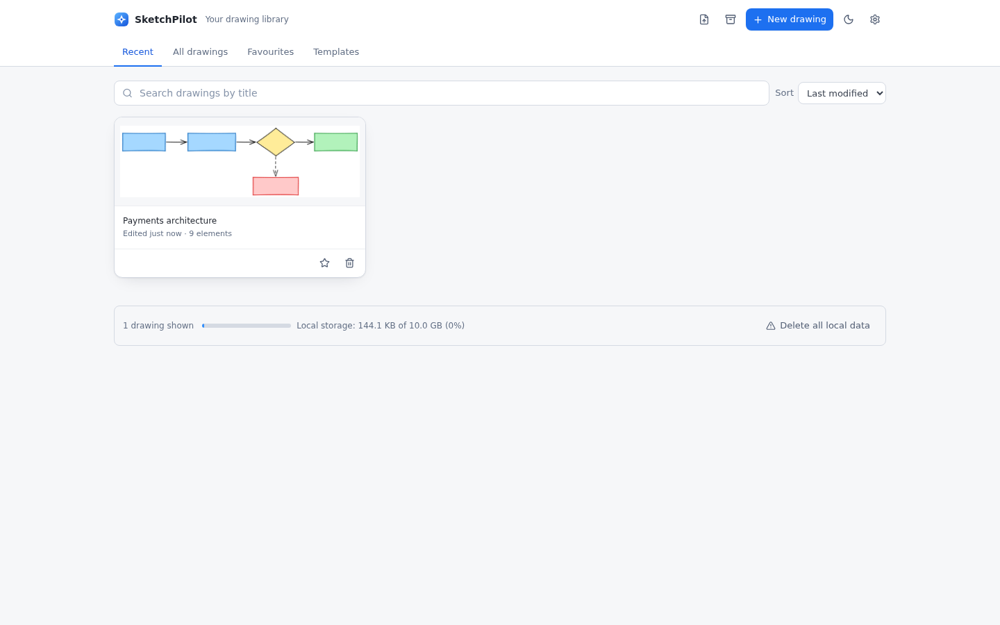
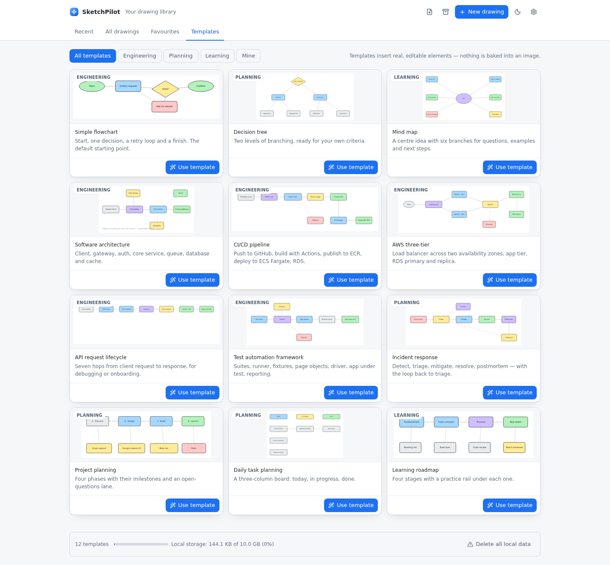
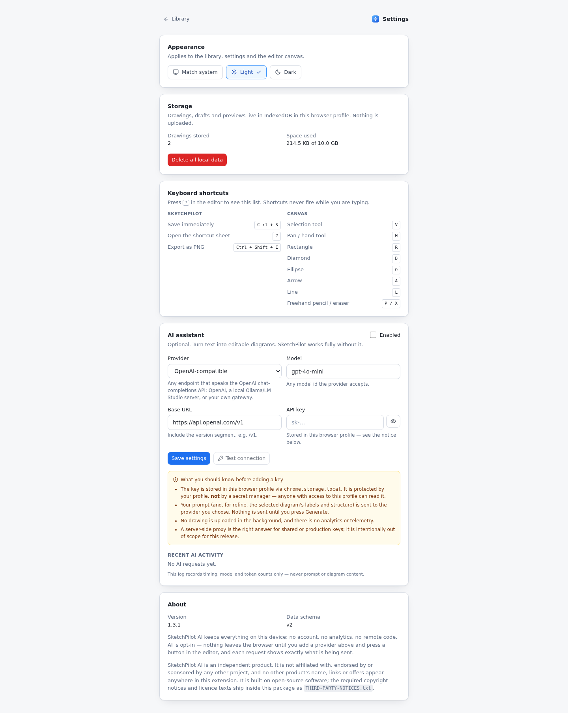
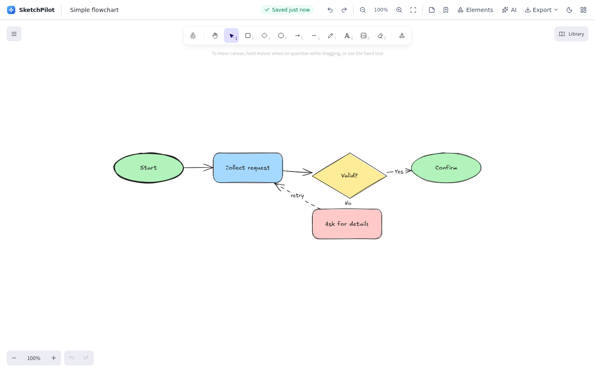
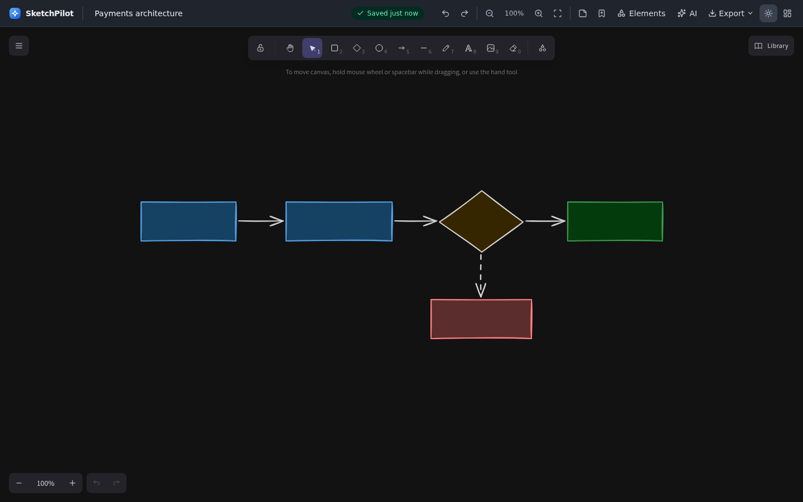
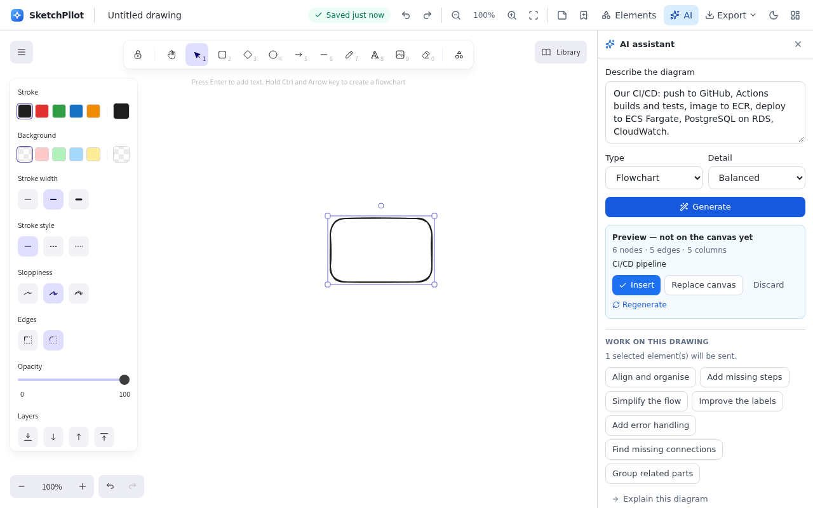
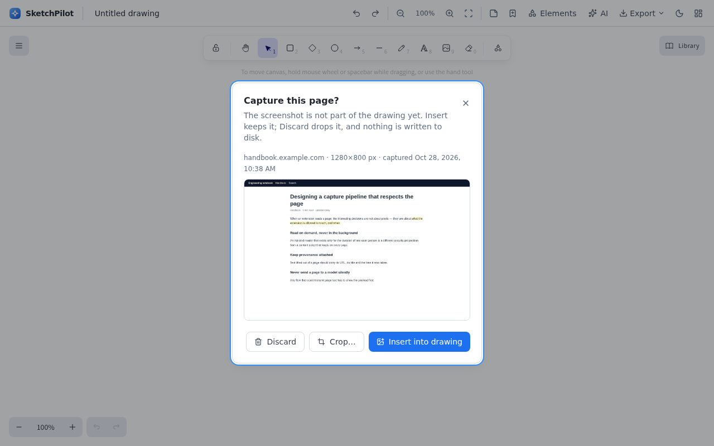
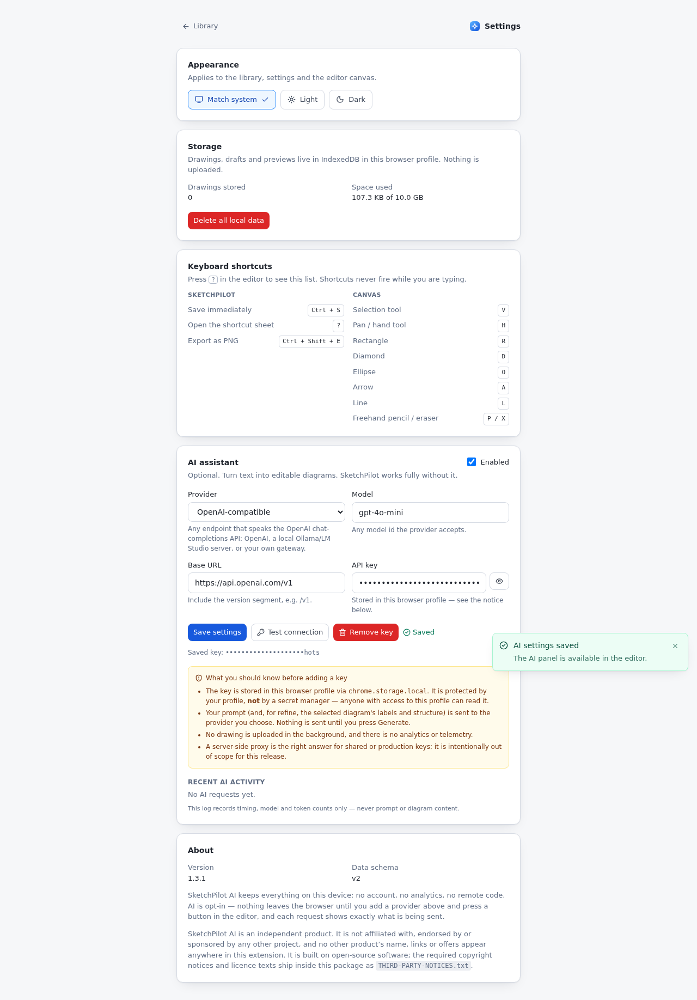

# SketchPilot AI

A Chrome extension for sketching and diagramming, built around a fast canvas that
opens straight from the toolbar. Everything is stored locally, works offline, and
requires no account.

**Status: Milestone 2 (v0.2.0) — drawing management.**
This is a working editor, not a mockup. What is *not* here yet is listed honestly in
[Not implemented yet](#not-implemented-yet).



<p align="center">
  
  
</p>
<p align="center">
  
  
</p>

## What works today

**Editor**
- Infinite canvas with pan, zoom (in/out/reset/fit-to-content) and a shortcut hint bar.
- Shapes, arrows, lines, freehand, text, images, and a one-click **sticky note**
  (rounded, filled rectangle with a bound, editable label).
- **Elements panel** (top bar or `Shift + P`): 16 standard system-diagram symbols — user, client,
  mobile, web server, worker, database, cache, object storage, queue, message broker, load
  balancer, API gateway, cloud, CDN/edge, firewall, external API — searchable by `db`, `sql`,
  `kafka`, `s3`, `waf`… **Click** to drop one in the middle of the canvas or **drag** it exactly
  where you want it. Each insert is *native, editable* grouped geometry with a label, so symbols
  recolour, resize, ungroup, save and export like anything drawn by hand. Monochrome, no fonts, no
  images, no network. See [`docs/feature-standard-elements.md`](docs/feature-standard-elements.md).
- Selection, move, resize, rotate, duplicate, delete; multi-select; grouping;
  snapping and alignment guides; frames.
- Full property editing via the engine's inspector: stroke/fill, stroke width and
  style, opacity, font family/size/alignment, arrowheads, layers, lock, position.
- Undo / redo from the top bar (single history model — the engine's).
- Rename a drawing inline; the title is part of the document.
- Light and dark theme, driven by a persisted preference (`system` follows the OS).

**Persistence**
- Autosave with an 800 ms debounce and a 10 s hard ceiling, serialised so writes can
  never interleave or land out of order.
- Visible `Unsaved changes → Saving… → Saved 12s ago` state, plus an inline banner
  when a save fails.
- Crash recovery: a separate draft revision is kept while you edit; if the tab dies
  mid-edit the editor offers to restore it on the next open.
- Drawings live in IndexedDB; small preferences in `chrome.storage.local`.
- Quota/blocked-storage failures produce an actionable message plus an export escape
  hatch instead of losing work.

**Library**
- Four tabs — Recent, All drawings, Favourites, Templates — with search by title and
  sort by last modified / created / name.
- **Thumbnails** generated from the saved drawing on idle time (never on the editing
  path), stored separately from the document, with a placeholder when unavailable.
- **Twelve built-in templates**: simple flowchart, decision tree, mind map, software
  architecture, CI/CD pipeline, AWS three-tier, API request lifecycle, test automation
  framework, incident response, project planning, daily task planning, learning
  roadmap. Each inserts real, editable shapes with **edge-to-edge bound arrows**.
- Templates are authored as data and instantiated by the drawing engine inside the
  editor, so the library page never loads the canvas.
- **Templates you save yourself** (editor → bookmark icon → name/description/category),
  listed under Templates → Mine, deletable, and included in backups.
- Whole-library **backup and restore** in one file; importing always creates copies, so
  a restore can never overwrite newer work.
- Import is validated and atomic: wrong type, newer schema version, duplicate element
  ids, non-finite geometry and oversized files are rejected with a clear message and
  nothing is written.
- Storage usage meter, bulk "delete all local data" with confirmation.



**AI (bring your own key)**
- **Text to diagram:** describe a flow in plain English → a validated plan → a preview
  you approve → real, editable shapes and bound arrows on the canvas. Insert next to
  what you have, or replace the canvas behind a confirmation that names the number of
  elements it will remove.
- **Work on the current drawing:** align and organise, add missing steps, simplify,
  improve the labels, add error handling, find missing connections, group related
  parts — every one goes through the same preview gate.
- **Read-only helpers:** explain the diagram, write documentation for it, convert it to
  Mermaid. Text results never touch the canvas; copy is one click.
- **Providers:** OpenAI, OpenRouter, or any OpenAI-compatible endpoint (local models
  included) with a custom base URL. Key, model and endpoint are set in Settings.
- **Nothing is sent until you press a button**, and nothing is drawn until you press
  Insert. A failed or unusable reply reports what went wrong, says "your drawing was not
  changed", and leaves the document byte-identical (asserted by tests).



**Browser capture**
- **Capture the visible page** from the popup, the right-click menu, or `Ctrl/⌘ + Shift + 9`
  → a review dialog shows the screenshot before anything is committed → *Insert* (with an
  optional crop) or *Discard*. Inserted images are real elements with their file data saved
  in the drawing, so they reopen offline; Discard leaves nothing behind, not even an empty
  drawing.
- **Note from selected text:** select text, right-click → *Create a sticky note from this
  selection*. Or use `Ctrl/⌘ + Shift + 8`, which reads the selection on demand.
- Every captured element keeps its **source**: URL, page title and capture time travel with
  the element, appear on a chip when you select it, and are included when you copy the text
  or export JSON.
- **Protected pages are refused honestly** — `chrome://`, the Web Store, other extensions'
  pages and local files each get their own explanation and a next step, never a silent
  failure or a raw Chrome error string.
- **Page text never reaches an AI provider silently.** Sending a selection to AI opens the
  assistant with the payload shown in full (host, model, characters, the exact text) and
  Generate stays disabled until you confirm it.

**Settings page**
- Appearance (system / light / dark, persisted and shared with the editor canvas),
  storage usage, the full shortcut reference, and version/schema information.
- **AI assistant settings**: provider, model, base URL, API key (masked, one-click
  removal), Test connection, and a content-free usage log.

**Export**
- PNG (2× scale, capped to avoid pathological file sizes), SVG (sanitised), and
  editable JSON — each named from the drawing title.
- The SVG path strips `<script>`, `<foreignObject>`, inline event handlers and
  `javascript:` URLs.

**Browser integration**
- Popup with New drawing, Open dashboard and recent drawings (loads in ~4 kB of JS,
  no canvas engine).
- MV3 service worker with a typed message router and an install flow that opens the
  editor once.

**Keyboard**
- One shortcut system in the app (`src/hooks/useShortcuts.ts`) that never fires while
  you are typing in a field or editing canvas text, plus a `?` sheet listing app shortcuts,
  canvas shortcuts and the **browser commands with the keys Chrome actually has bound**
  (rebind them at `chrome://extensions/shortcuts`; the sheet reads the live bindings).
- `Ctrl/⌘+S` saves immediately, `Ctrl/⌘+Shift+E` exports a PNG. Browser-level:
  `Ctrl/⌘+Shift+7` new drawing, `Ctrl/⌘+Shift+9` capture the page,
  `Ctrl/⌘+Shift+8` note from selection, `Ctrl/⌘+Shift+K` popup.

## What is deliberately not implemented yet

Kept as a first-class part of the plan rather than half-built: the **side panel** (optional
in the plan, deferred to the post-1.0 backlog rather than stubbed), remaining AI diagram
types (sequence, org chart — listed but visibly marked "coming soon"), Mermaid import,
streaming generation, cloud sync and collaboration. The phases, tasks and exit gates are in
`../sketchpilot-plan/`. Buttons for unshipped features are not rendered at all.



## Install and run

Requirements: Node.js 20 LTS or newer, Chrome/Chromium 110+. The commands below work
unmodified in **PowerShell**, **cmd.exe**, **bash** and **zsh** — no script relies on POSIX-only
shell syntax (there is a test that enforces this).

```bash
# 1. Install dependencies
npm install                          # plain install; `.npmrc` pins legacy-peer-deps
                                     # (the canvas engine's peers lag our React 18.3 pin — ADR-002)

# 2. Verify the project
npm run lint                         # ESLint 9, flat config
npm run typecheck                    # strict TypeScript, no emit
npm test                             # unit + component tests (Vitest)
npm run test:coverage                # same, with the 80 % thresholds enforced

# 3. Build the extension
npm run build                        # typecheck → vite build → release guard

# 4. Load it in Chrome
#    - open chrome://extensions
#    - enable "Developer mode"
#    - click "Load unpacked"
#    - select the generated dist/ folder
#    - pin SketchPilot AI to the toolbar and click the icon
```

Build a store/release ZIP (pick the one for your shell):

```bash
# bash / zsh
cd dist && zip -qr ../release/sketchpilot-1.3.1.zip . && cd ..
```

```powershell
# PowerShell
Compress-Archive -Path dist\* -DestinationPath release\sketchpilot-1.3.1.zip -Force
```

```bat
:: cmd.exe (Windows 10+ ships tar)
tar -a -c -f release\sketchpilot-1.3.1.zip -C dist *
```

Or simply right-click `dist/` → *Send to* → *Compressed (zipped) folder*, then rename it:
the ZIP must contain `manifest.json` at its **root**, not inside a `dist` folder.

`npm run build` also runs `scripts/check-build.mjs`, which fails the build if the
manifest drifts from `PERMISSIONS.md`, if any shipped page references a remote
resource, if a bundle outside the documented allowlist contains `eval`, or if the
popup/dashboard entries grow past their budgets.

### End-to-end tests

```bash
npx playwright install --with-deps chromium   # once
npm run build                                 # e2e runs against dist/
npm run test:e2e                              # 53 specs, ~4 minutes
npm run perf                                  # performance budgets, printed as a table
```

The suite launches a real Chromium with the unpacked extension and exercises every
surface: install → service worker, create/draw, undo/redo, autosave + reload, two drawings
staying separate, PNG/SVG/JSON export (downloaded files are inspected), invalid and valid
import, dashboard search, popup rendering, theme switching, templates, AI generation with a
stubbed provider, capture review/insert, keyboard and accessibility behaviour (focus trap,
reduced motion, accessible names), the performance budgets, and a hard assertion that **no
request ever leaves the extension origin**.

The specification's §14 matrix — all eighteen required scenarios and the named test that
covers each — is in [`docs/test-matrix.md`](docs/test-matrix.md), generated from
`src/tests/scenario-map.ts` and checked for staleness by the test suite.

## Scripts

| Command | What it does |
| --- | --- |
| `npm run dev` | Vite dev server (UI work without the extension shell). |
| `npm run lint` | ESLint over `src/`, `tests/`, `scripts/` and configs. |
| `npm run build` | Typecheck, production build to `dist/`, then the release guard. |
| `npm run build:only` | Build without the typecheck/guard (fast iteration). |
| `npm run typecheck` | `tsc --noEmit` in strict mode. |
| `npm test` / `npm run test:watch` | Vitest (jsdom + fake-indexeddb). |
| `npm run test:coverage` | Vitest with coverage; fails below the documented thresholds. |
| `npm run test:e2e` | Playwright suite (53 specs) against the built extension. |
| `npm run perf` | Measures the performance budgets on the packaged build (`docs/performance.md`). |
| `npm run docs:matrix` | Regenerates `docs/test-matrix.md` from the §14 scenario map. |
| `npm run check:build` | Run the release guard against an existing `dist/`. |
| `npm run verify` | Lint + typecheck + unit tests + full build. |

## Architecture

```
src/
  background/        MV3 service worker: typed message router (stateless)
  popup/             quick actions + recents (kept free of the canvas engine)
  dashboard/         library: search, sort, favourites, import, storage usage
  editor/
    engine/          CanvasAdapter — the only code that touches Excalidraw
    EditorApp.tsx    layout, autosave wiring, export orchestration, AI apply path
    AiPanel.tsx      prompt/preview/approval gate, refine actions, AI consent gate
    CaptureReview.tsx  screenshot crop/insert dialog + captured-text actions
    SourceChip.tsx   on-canvas provenance chip for captured content
    useDrawingSession.ts  load → recovery → autosave → flush lifecycle
  capture/           urls.ts (which pages Chrome allows), model.ts (capture +
                     source-reference contract), service.ts (capture flow with an
                     injectable browser), menu.ts (context-menu routing)
  ai/                schemas.ts (zod contract), validate.ts, repair.ts, layout.ts
                     (deterministic graph→geometry), prompt.ts, generate.ts
                     (orchestrator), credentials.ts, providers/ (one
                     OpenAI-compatible adapter for OpenAI/OpenRouter/local)
  templates/         catalog.ts (12 built-ins as data), dsl.ts, instantiate.ts
                     (spec → engine elements), preview.ts (pure SVG previews),
                     service.ts (built-ins + user templates)
  settings/          appearance, storage, shortcuts, about
  hooks/             useShortcuts (capture-phase, text-entry aware)
  components/        design system: Button, IconButton, Dialog, Toast, Field, states
  storage/
    schemas.ts       zod schemas; the single source of truth for persisted shapes
    repository.ts    IndexedDB (drawings, metadata, drafts) behind an interface
    autosave.ts      debounced, serialised save controller (framework-free)
    documents.ts     document factory + revision helpers
  editor/thumbnails.ts  idle-time thumbnail generation for the library
  export/            io.ts (validate/import/sanitise/download), render.ts (PNG/SVG),
                     archive.ts (whole-library backup/restore)
  platform/          the only module that touches chrome.* APIs (browser.ts,
                     capture.ts: tabs/scripting/commands/session storage)
  lib/               errors-as-values, formatting, theme
  tests/             unit + component tests
tests/e2e/           Playwright specs that drive the real extension
scripts/             release guard
docs/                ADR-001 (engine), ADR-002 (React version), ADR-003 (AI),
                     milestone reports, privacy-review-m4.md
```

Design rules the code sticks to:

- **Schema first.** Anything persisted or imported is described by a zod schema;
  types are inferred, never hand-written twice.
- **One write path.** Import, restore and (later) AI all produce a `DrawingDocument`
  that is validated, then saved through the repository. That is what makes "invalid
  input cannot corrupt a drawing" structural rather than a promise.
- **Errors are values.** Expected failures return `Result<T, AppError>` with a
  user-facing message *and* a next step; nothing sensitive is ever included.
- **The domain has no React and no `chrome`.** Storage, autosave, import and export
  are plain TypeScript, which is why they are cheap to test.

## Independence, branding and licences

SketchPilot AI is a product of its own. Two separate things are at stake here, and it is worth
being precise about which is which:

**Branding — none of anybody else's.** No third-party product name, link, logo, upsell or
"browse our library" hand-off appears anywhere in the interface. That meant removing four things
that the drawing engine ships by default and that had no business in this app:

| Removed | Why |
| --- | --- |
| The **"Excalidraw links"** menu group (GitHub, X, Discord, excalidraw.com) | Not our links. The canvas menu is now SketchPilot's own: canvas background, clear canvas, keyboard shortcuts. |
| The engine's **Help** dialog | It was four external links (docs, blog, issue tracker, YouTube). `?` opens SketchPilot's own shortcut sheet instead. |
| The library panel's **"Browse libraries"** button | Opened a third-party site *with a referrer token containing the extension ID*. The library you have is the dashboard. |
| **Web Embed** in *More tools* | Loads a live remote page inside the canvas — incompatible with an offline, permission-minimal extension. The manifest CSP now refuses frames outright (`frame-src 'none'`), so it fails closed even if some future UI tried. |
| **Mermaid to …** importer, its "Text to diagram" tab, palette commands and the magic-frame action | Another product's converter, and not bundled — so it could never have worked. Switched off at the source (`aiEnabled={false}`). *More tools* now reads exactly **Frame tool · Laser pointer**. |

`tests/e2e/brand.spec.ts` walks every surface, toolbar tooltip, panel and dialog and fails the
suite if any other product's name becomes visible again.

**Attribution — all of it.** Removing branding is not removing attribution: MIT, Apache-2.0 and
ISC require the copyright notice and permission text to travel with the shipped code. So they
do, in full:

- [`THIRD-PARTY-NOTICES.txt`](public/THIRD-PARTY-NOTICES.txt) is generated from the installed
  production dependency tree (`npm run notices`) and ships at the root of the extension package.
  The build fails if it is missing or incomplete, and an end-to-end test reads it out of the
  installed package to check the MIT text, the Apache text and the notices of the components we
  bundle.
- SketchPilot's own code is [MIT licensed](LICENSE).
- Nothing in the notices implies endorsement, partnership or affiliation by anyone.

## Privacy and security posture

- Permissions: `storage`, `activeTab`, `scripting`, `contextMenus`, `clipboardWrite`. **No
  host permissions, no content scripts, no `tabs` permission.** `PERMISSIONS.md` is the
  contract and `scripts/check-build.mjs` parses it — the build fails if the manifest drifts.
- No analytics, no telemetry, no remote code. Fonts ship inside the extension
  (Excalidraw wants to fetch them from a CDN by default — see ADR-001).
- **Capture reads a page only when you ask.** `activeTab` + `scripting` grant one-shot
  access to the tab in front of you at the moment you click; the selection reader is
  injected for a single call. Screenshots wait in memory (`chrome.storage.session`) and are
  deleted the moment the review dialog opens. Full list of what leaves the browser:
  `docs/privacy-review-m4.md`.
- **AI is opt-in and key-based.** Nothing is transmitted until you add a provider in
  Settings and press a button in the AI panel. When you do, your prompt and the current
  diagram (labels and connections only) are sent **directly** to the endpoint you
  configured, with your key — no SketchPilot server exists, and no host permissions are
  requested to make that call. If you never configure a provider, the extension makes
  zero network requests.
- **The key** is stored in `chrome.storage.local` (the extension's own local storage),
  never synced, shown masked after saving, and removable in one click. It is sent only
  to the base URL you chose.
- **The usage log** in Settings records kind of request, model, token counts and
  duration. It never stores your prompt, the diagram, or the reply, and can be cleared.
- Untrusted input (imported JSON, page text, AI output) is validated, repaired within
  strict bounds, and never thrown at the canvas unvalidated — see
  `docs/adr-003-ai-provider-and-layout.md`.

## Known limitations

- Undo/redo is the engine's stack; there is no cross-session undo and no documented
  history cap beyond what the engine keeps.
- The right-hand inspector is still Excalidraw's own panel, restyled to match. The AI
  panel is SketchPilot's own (see `docs/screenshots/editor-ai-*.png`).
- AI output is a graph, not a layout: the model decides what connects to what, and
  SketchPilot decides where boxes go. Diagrams with many parallel branches are correct
  but plain; there is no manual "tidy up" of an AI result beyond the refine actions.
- Two diagram types (sequence, org chart) are listed but disabled; refine actions cover
  structure, not styling.
- A drawing opened in two tabs last-write-wins; there is no merge or lock.
- A thumbnail can lag one save behind: it regenerates at most every 8 s, on idle.
- Templates are inserted by the editor; a blank "Use template" tab needs the editor to
  finish loading before the elements appear (~1 s).
- The engine's Emscripten wasm-glue chunk contains `new Function`; it is allow-listed in
  the release guard with a written reason.
- Excalidraw's CJK handwriting face (`Xiaolai`, 13 MB of unicode-range subsets) is **not
  shipped** in the 1.0 package, so CJK text renders in the system font. Remove the entry from
  `SKIPPED_FONT_FAMILIES` in `vite.config.ts` to include it.
- The canvas menu and panels carry **no outbound links**: the engine's "Excalidraw links"
  group, its Help dialog (docs/blog/GitHub/YouTube) and the library panel's "Browse
  libraries" button are removed, because none of them are part of this product. Shortcuts are
  documented in SketchPilot's own `?` sheet, reachable from the canvas menu.
- Mermaid import is **not part of the product** (`src/stubs/mermaid-to-excalidraw.ts`). It would add
  ~4 MB of unused graph-rendering code to an offline extension; the engine's Mermaid
  dialog is therefore inert. Delete the stub and its Vite alias to enable it.

## Documentation map

| Document | What is in it |
| --- | --- |
| [`PRIVACY.md`](PRIVACY.md) | What is stored, what can leave your machine, and the honest limits of key storage. |
| [`PERMISSIONS.md`](PERMISSIONS.md) | Every permission, its purpose, and what is deliberately *not* requested. Enforced by the build. |
| [`TROUBLESHOOTING.md`](TROUBLESHOOTING.md) | Build, permissions, AI, storage, import/export and CI problems. |
| [`CHANGELOG.md`](CHANGELOG.md) | What changed in each release. |
| [`LICENSE`](LICENSE) · [`THIRD-PARTY-NOTICES.txt`](public/THIRD-PARTY-NOTICES.txt) | Our own MIT licence, and the notices of the open-source components we ship. |
| [`docs/test-matrix.md`](docs/test-matrix.md) | §14's eighteen scenarios, each mapped to the named test covering it. |
| [`docs/feature-standard-elements.md`](docs/feature-standard-elements.md) | The Elements panel: what ships, how it behaves, and how to add a symbol. |
| [`docs/performance.md`](docs/performance.md) | The performance budgets and the measured numbers behind them. |
| [`docs/security-review.md`](docs/security-review.md) | Security checklist, threat model, store-facing permission justifications. |
| [`docs/branding-and-licensing.md`](docs/branding-and-licensing.md) | What was removed for branding, what was kept for licensing, and how each is enforced. |
| [`docs/definition-of-done.md`](docs/definition-of-done.md) | The §17 audit, line by line, with evidence and known limitations. |
| [`docs/adr-001`–`003`](docs/) | Why the stack, the provider layer and the AI layout pipeline look the way they do. |
| [`docs/milestone-1`–`5`-report](docs/) | What each phase actually delivered, including the bugs found on the way. |
| [`docs/store-listing.md`](docs/store-listing.md) | Chrome Web Store copy, permission justifications and screenshot set. |
| [`docs/store-submission-checklist.md`](docs/store-submission-checklist.md) | What is verified for the Web Store, the review risks, and what only the account owner can do. |

## Troubleshooting

See `TROUBLESHOOTING.md`.
