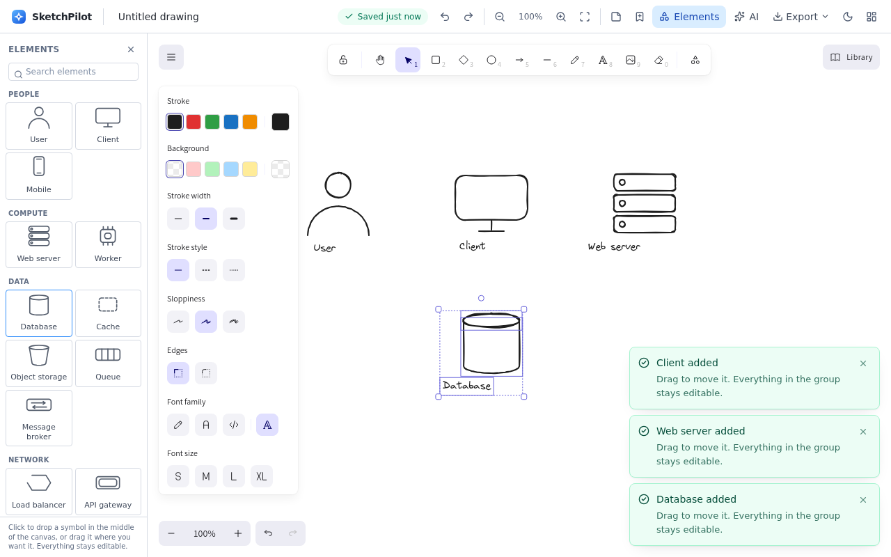
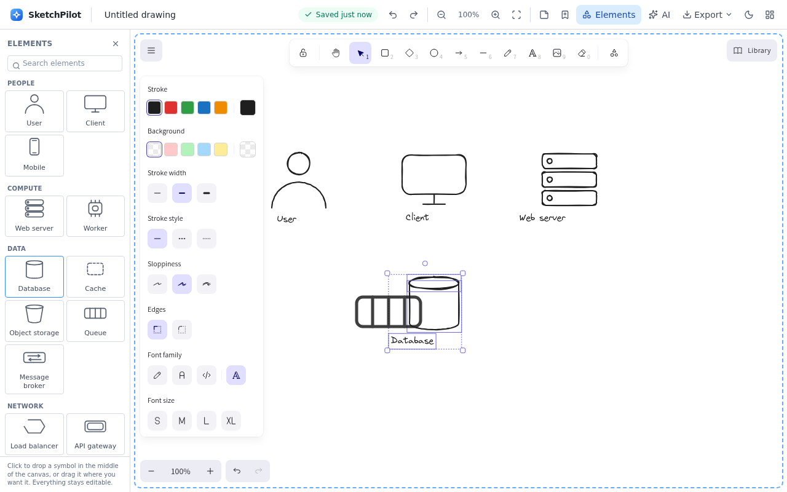

# Standard diagram elements

SketchPilot's **Elements** panel gives you the symbols people redraw in every "explain the system"
sketch — a user, a client, a server, a database — without redrawing the geometry by hand.

Open it with the **Elements** button in the top bar, or **Shift + P**. It is closed by default so
the canvas keeps the space; the extension remembers your choice.





## What ships (16 symbols)

| Role | Symbols |
| --- | --- |
| **People** | User · Client (desktop/browser) · Mobile |
| **Compute** | Web server · Worker |
| **Data** | Database · Cache · Object storage · Queue · Message broker |
| **Network** | Load balancer · API gateway · Cloud · CDN / Edge · Firewall · External API |

The search box matches labels, roles and the words people actually type:

| You type | You get |
| --- | --- |
| `db`, `sql`, `postgres`, `mysql` | Database |
| `redis`, `memcached` | Cache |
| `s3`, `bucket`, `blob` | Object storage |
| `kafka`, `pubsub`, `rabbitmq` | Message broker · Queue |
| `waf`, `security` | Firewall |
| `aws`, `azure`, `gcp`, `internet` | Cloud |

## How they behave

- **They are ordinary elements.** A database is a top ellipse, a body polyline and a label sharing
  one group id. Select it, recolour it, **resize the group** (every part scales together and the
  shape keeps its proportions), retype the label, or ungroup it and move the parts independently. Nothing is an image, a locked template or a plugin.
- **Click or drag.** Clicking inserts the symbol in the middle of the canvas; **dragging** carries it
  and drops it exactly where the pointer is. Either way it arrives selected, with the canvas
  focused, so Delete, arrow-key nudging and dragging work straight away — and a single
  <kbd>Ctrl</kbd>+<kbd>Z</kbd> removes the whole symbol.
- **Drops land where they look.** The pointer position is converted to scene coordinates, so a drop
  is correct at any zoom or scroll position. Releasing outside the canvas (over the panel, the top
  bar or the window edge) inserts nothing, and <kbd>Esc</kbd> cancels a drag in flight.
- **A press only becomes a drag after a few pixels.** A slightly shaky click is still a click, so
  nobody accidentally scatters half-finished symbols by tapping the panel.
- **They save and export like anything else.** Autosave, PNG/SVG/JSON export, thumbnails and
  re-import all work unchanged — the library adds no new element types.
- **Monochrome by design.** Ink strokes, no fills: a diagram looks the same on paper and stays
  legible in both light and dark mode. Inserted symbols take the ink colour of the theme they were
  inserted in.
- **Keyboard only works too.** Opening the panel focuses the search box; <kbd>Tab</kbd> reaches the
  cards, <kbd>↑</kbd>/<kbd>↓</kbd> walk them, <kbd>Enter</kbd> inserts, <kbd>Esc</kbd> closes.

## What it deliberately is not

- **No cloud-provider stencils.** AWS / Azure / GCP icon sets are trademarks with their own usage
  terms, and adding them would mean shipping third-party artwork. The symbols here are generic,
  built from primitives, and safe to publish.
- **No images or fonts.** Every preview and every inserted symbol is generated from numbers in
  `src/editor/palette/catalog.ts`, so the panel adds no files to the package and makes no network
  request.
- **No new permissions or storage fields.** The feature is editor-local.

## For developers

```
src/editor/palette/catalog.ts   recipes: geometry + label + role + search aliases
src/editor/palette/build.ts     recipe → engine element skeletons (grouping, label, normalisation)
src/editor/palette/previews.tsx inline-SVG thumbnails drawn from the same geometry
src/editor/palette/PalettePanel.tsx  the panel (search, groups, keyboard, focus, drag-to-place)
src/editor/palette/drop.ts      pure drop maths: pointer → scene coordinates, hit-testing
```

To add a symbol, add one entry to `PALETTE_SYMBOLS`: a box size, a few shapes in box coordinates and
a list of search aliases. The panel, the preview, the tests and the insert path pick it up
automatically. Keep every shape inside `box`, and every polyline's points are normalised for you.

Three invariants are enforced by unit tests (`src/tests/palette-catalog.test.ts`):

1. every element of a symbol shares one group id;
2. every polyline starts at `[0, 0]` — the engine treats a line's `x`/`y` as the position of its
   first point, so a recipe that breaks this "explodes" the first time the group is dragged;
3. every polyline's `width`/`height` is the real extent of its points — left at the default `0`,
   the symbol draws correctly but **collapses when resized**, because the engine scales line points
   against that box.

End-to-end coverage lives in `tests/e2e/palette.spec.ts` (13 tests): default-closed state, reload
memory, all 16 listed and searchable, grouped insertion, single-step undo, every symbol inserted
through the UI, theme ink, keyboard operation, drag-and-drop placing (position verified by comparing two drops),
refusal to drop outside the canvas, escape-to-cancel, the click-vs-drag threshold, the in-flight
ghost, a real resize-handle drag that checks every part scales by the same factor, and an assertion
that inserting stays offline and adds no third-party name.
